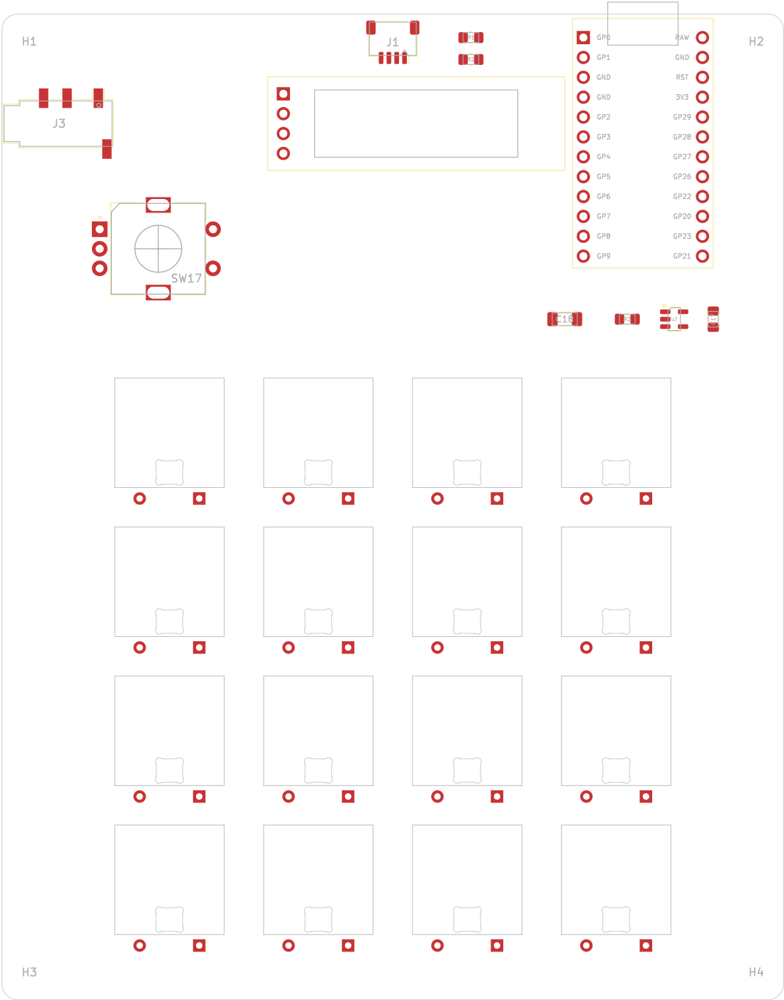

# Macropad 4x4 v2

A 16-key hot-swap macropad built around an RP2040 Pro Micro. It has per-key RGB, a rotary encoder with a push button, a 0.91" OLED, a Qwiic port and a TRRS jack. It runs QMK, and VIA support is included.



> **Status:** The PCB is routed in KiCad 9 (2 layers) and Gerbers are exported in `kicad/`. Drill files still need to be exported before ordering. The board and firmware have not been tested on real hardware yet.

## Features

- 4×4 MX layout with Kailh hot-swap sockets and 1N4148 diodes (COL2ROW)
- 16 × SK6812MINI-E reverse-mount RGB LEDs, one under each switch
- 74AHCT1G125 level shifter for the 3.3 V → 5 V LED data line
- Alps EC11E rotary encoder with push switch
- 0.91" SSD1306 128×32 OLED showing the active layer, Num/Caps Lock and RGB status
- Qwiic / STEMMA QT port (JST SH 4-pin) with 4.7 kΩ I2C pull-ups
- PJ-320D TRRS jack wired to UART (GP8/GP9), kept free for a future link
- USB-C via the controller; 2-layer, 1.6 mm board, 100 × 126 mm, 4 × M2 mounting holes

## Repository layout

| Path | Contents |
|---|---|
| `kicad/` | KiCad 9 project: schematic, routed PCB, project symbol library |
| `kicad/*.gbr`, `kicad/macropad-job.gbrjob` | Gerber files for fabrication (copper, mask, paste, silkscreen, edge cuts) |
| `Cad/macropad_assembly.step` | 3D assembly of the board, plate and case (STEP) |
| `docs/` | `schematic.pdf`, `pcb_front.png`, `pcb_back_mirrored.png` |
| `macropad_v2_firmware/firmware_source/` | QMK keyboard source (`handwired/macropad4x4v2`) |
| `macropad_v2_firmware/*.uf2` | Prebuilt firmware: `default` and `via` keymaps |
| `macropad_v2_firmware/via_macropad4x4v2.json` | VIA definition for loading the board in the VIA app |
| `macropad_v2_BOM.csv` | Bill of materials with quantities and estimated USD prices |

## Pin map

| Function | Controller pin |
|---|---|
| Rows 0–3 | GP5, GP4, GP3, GP2 |
| Columns 0–3 | GP6, GP7, GP21, GP23 |
| Encoder A / B / switch | GP26 / GP27 / GP28 |
| I2C SDA / SCL (OLED, Qwiic) | GP0 / GP1 |
| RGB data (to level shifter) | GP29 |
| TRRS UART TX / RX | GP8 / GP9 |
| Free | GP20, GP22, RST |

The LEDs are chained in a serpentine: row 0 left → right, row 1 right → left, row 2 left → right, row 3 right → left.

## Firmware

The QMK source lives in `macropad_v2_firmware/firmware_source/handwired/macropad4x4v2`. It uses a small custom matrix (`matrix.c`) that scans the 4×4 keys and adds the encoder push switch as a fifth row, so the matrix is 5 × 4.

### Flashing a prebuilt file

1. Put the board in bootloader mode: hold **BOOT** while plugging in USB, double-tap **RESET**, or press `QK_BOOT` (RGB layer, bottom-left key).
2. A drive named `RPI-RP2` appears.
3. Drag `handwired_macropad4x4v2_default.uf2` or `handwired_macropad4x4v2_via.uf2` onto it. The board reboots on its own.

### Building from source

Copy the `handwired/macropad4x4v2` folder into `keyboards/handwired/` of a QMK checkout, then run:

```sh
qmk compile -kb handwired/macropad4x4v2 -km default
qmk compile -kb handwired/macropad4x4v2 -km via
```

### Default keymap

The encoder knob sits above the grid. Pressing it is the first key in each layer.

| Layer | Encoder press | Encoder turn | Keys |
|---|---|---|---|
| 0 – Numpad | Mute | Volume down / up | Numpad 0–9, `.`, `/`, `*`, `-`, Enter. Bottom-right holds layer 1 |
| 1 – Media / Nav | Play/Pause | Previous / next track | Prev, Play, Next, arrows, Home/End, PgUp/PgDn, Num Lock, Calculator, Backspace. Top-right toggles layer 2 |
| 2 – RGB | RGB on/off | Brightness down / up | RGB toggle, mode next/previous, hue/sat/brightness/speed up and down. Bottom-left = `QK_BOOT` |
| 3 – Spare | — | — | Empty, for your own mappings |

### VIA

Flash the `via` build, open [usevia.app](https://usevia.app), and load `via_macropad4x4v2.json` under **Settings → Show Design tab → Design**. USB VID/PID: `0xFEED` / `0x4402`.

## Bill of materials

Full list with prices: [`macropad_v2_BOM.csv`](macropad_v2_BOM.csv). The estimated total is about **$238 USD** in parts, before shipping and taxes. Most of that is the case, keycaps and PCB order; the electronics alone are much cheaper.

| Qty | Refs | Part |
|---|---|---|
| 1 | — | PCB, 2-layer 1.6 mm (JLCPCB, ENIG) |
| 1 | U1 | RP2040 Pro Micro, Community Edition pinout (Sea-Picro / Elite-Pi) + 2 × 12-pin headers |
| 16 | SW1–SW16 | Kailh hot-swap socket PG151101S11 |
| 16 | D1–D16 | 1N4148, DO-35 |
| 16 | LED1–LED16 | SK6812MINI-E |
| 17 | C1–C17 | 100 nF, 0805 |
| 1 | C18 | 10 µF, 1206 |
| 1 | U2 | 74AHCT1G125, SOT-23-5 |
| 1 | R3 | 330 Ω, 0805 |
| 2 | R1, R2 | 4.7 kΩ, 0805 |
| 1 | J1 | JST SH 4-pin SM04B-SRSS-TB (Qwiic) |
| 1 | J2 | 0.91" SSD1306 128×32 I2C OLED + 4-pin female header |
| 1 | SW17 | Alps EC11E18244AU encoder with push switch + knob |
| 1 | J3 | PJ-320D TRRS jack |
| 4 | H1–H4 | M2 × 6 mm screws (+ heat-set inserts for a printed case) |
| 16 | — | MX switches (Gateron Oil King V2) + 1u keycaps |
| 1 | — | Switch plate (1.5 mm aluminium) and case (CNC aluminium or 3D printed) |

## Ordering the PCB

1. In KiCad, open `kicad/macropad.kicad_pcb` and run **Inspect → Design Rules Checker** until it reports 0 errors and 0 unconnected items.
2. Export drill files: **File → Fabrication Outputs → Drill Files** (Excellon, into the `kicad/` folder).
3. Zip the `.gbr` and `.drl` files and upload the zip to JLCPCB (2 layers, 1.6 mm, 100 × 126 mm).

## ⚠️ Check before you order or plug in

1. **Controller pinout.** It must be a Pro Micro RP2040 with the Community Edition pinout (Elite-Pi, Sea-Picro, Liatris, Frood). A Raspberry Pi Pico or RP2040-Zero will not fit.
2. **LED footprint.** The SK6812MINI-E pads follow the marbastlib layout (1 VDD, 2 DOUT, 3 GND, 4 DIN). Compare it against the datasheet of the LEDs you buy.
3. **OLED pin order.** The footprint is GND, VCC, SCL, SDA. Some modules use VCC, GND, SCL, SDA. Check yours first.
4. **TRRS.** Never plug or unplug the TRRS cable while USB is connected. Ring 2 carries 5 V.
5. **RGB power.** 16 LEDs at full white can draw about 1 A. The firmware caps brightness at 100/255 to stay within USB's 500 mA.
6. **OLED orientation.** The firmware rotates the display 180°. If yours reads upside down, change `OLED_ROTATION_180` to `OLED_ROTATION_0` in `macropad4x4v2.c`.

## Credits

- Hot-swap pad geometry: ai03 MX_Alps_Hybrid
- SK6812MINI-E pad layout and cutout: marbastlib by ebastler (CERN-OHL-P)
- Firmware: [QMK](https://qmk.fm), GPL-2.0-or-later

Designed by [Sk Izaz Ahmed](https://github.com/SkIzazAhmed).
